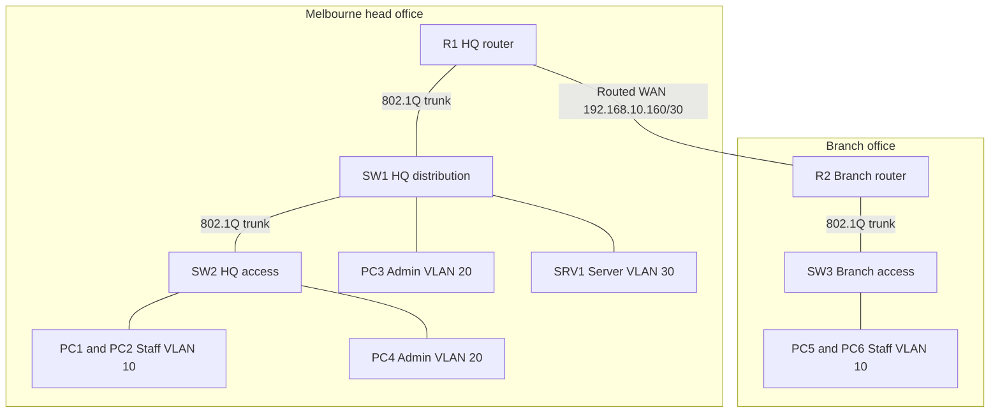

# Project A two site network lab

Designed 29 October 2026. This is a learning design, not a completed implementation or a production deployment.

## Requirements

Build a Melbourne head office and a branch office in Cisco Packet Tracer. Use two Cisco 2911 routers, three Cisco 2960 switches, six PCs and one Server-PT. Simulate larger departments through the subnet capacities; do not add every planned host.

Use 192.168.10.0/24 as the address pool. Required usable address counts below include the gateway and all planned devices. Use static IP addresses initially. Provide local inter-VLAN routing with router subinterfaces and 802.1Q trunks. Connect the routers by a routed Ethernet link simulating a WAN; do not trunk VLANs between sites.

## Topology

VLAN 99 provides switch management at each site. VLAN 10 and VLAN 99 reuse the same IDs at different sites but have separate subnets and broadcast domains. Use VLAN 999 as an unused native VLAN on trunks, with no IP address or end devices. Explicitly allow 10,20,30,99,999 on HQ trunks and 10,99,999 on the branch trunk.

## VLSM address plan

| Network | VLAN | Required usable addresses 
|---|---|---:|
| HQ staff | 10 | 50 |
| HQ admin | 20 | 20 |
| Branch staff | 10 | 25 |
| HQ servers | 30 | 10 |
| HQ management | 99 | 5 |
| Branch management | 99 | 5 |
| Router WAN link | None | 2 |

All abbreviated addresses begin with 192.168.10. Reserve .164–.255 for future allocation. Allocate largest subnets first. Usable capacity is 2^(32-prefix) minus 2: /26 = 62, /27 = 30, /28 = 14, /29 = 6, /30 = 2.

## Physical connections

| Device port | Connects to | Purpose |
|---|---|---|
| R1 G0/0 | SW1 G0/1 | HQ trunk |
| SW1 G0/2 | SW2 G0/1 | HQ inter-switch trunk |
| R1 G0/1 | R2 G0/1 | Routed WAN |
| R2 G0/0 | SW3 G0/1 | Branch trunk |
| SW1 F0/1 | PC3 | Access VLAN 20 |
| SW1 F0/2 | SRV1 | Access VLAN 30 |
| SW2 F0/1 and F0/2 | PC1 and PC2 | Access VLAN 10 |
| SW2 F0/3 | PC4 | Access VLAN 20 |
| SW3 F0/1 and F0/2 | PC5 and PC6 | Access VLAN 10 |

Use Packet Tracer automatic cable selection. If your device model uses different interface names, map the same logical connections to the available ports.

## Initial device addressing

- R1 G0/0.10 = .1/26; G0/0.20 = .97/27; G0/0.30 = .129/28; G0/0.99 = .145/29.
- R2 G0/0.10 = .65/27; G0/0.99 = .153/29.
- R1 G0/1 = .161/30; R2 G0/1 = .162/30.
- SW1 VLAN 99 SVI = .146/29; SW2 VLAN 99 SVI = .147/29; both use default gateway .145.
- SW3 VLAN 99 SVI = .154/29; default gateway .153.
- PC1 = .10/26; PC2 = .11/26; gateway .1.
- PC3 = .100/27; PC4 = .101/27; gateway .97.
- SRV1 = .130/28; gateway .129.
- PC5 = .70/27; PC6 = .71/27; gateway .65.

## Build stages and acceptance criteria

1. Place, name and cable all devices. Add subnet labels. Save the initial topology.
2. Create VLANs and access ports; configure trunks. Verify that PC1 can ping PC2 and PC3 can ping PC4 across the HQ trunk. Use static addresses.
3. Configure router subinterfaces and switch management. Verify that each endpoint reaches its gateway and HQ VLANs can communicate.
4. Address the WAN and establish single-area OSPF in area 0. Use passive interfaces for LAN subinterfaces and form the adjacency only across the WAN. Verify learned remote routes and branch-to-HQ connectivity.
5. Configure SRV1 HTTP service. Verify that a branch PC opens its page by IP address. Then add DHCP pools on each local router for staff/admin networks, excluding gateways and reserved static addresses. Preserve SRV1 and switch static addresses.
6. Apply an ACL preventing branch staff from reaching the HQ management subnet while preserving access to the HQ server and other intended traffic. Verify both blocked and permitted traffic. Add SSH management and disable unused switch ports.
7. Introduce and resolve one fault at a time: wrong endpoint mask, wrong access VLAN, missing trunk VLAN, wrong gateway. Record symptom, checks, cause, correction and retest.

Save the .pkt file at milestones. Capture show vlan brief, show interfaces trunk, show ip interface brief, show ip route and show ip ospf neighbor as appropriate. Include a test table with source, destination, expected outcome and actual result. Update the resume only after completing and documenting the relevant work.

## Reference

Cisco inter-VLAN routing with an external router: https://www.cisco.com/c/en/us/support/docs/lan-switching/inter-vlan-routing/14976-50.html

## Result Outputs

### Setting up interfaces in packet tracer 

### Melbourne office HQ IP configuration

**PC1**

**PC2**

**PC3**

**PC4**

**Server1**

### VLSM
Address Pool 192.168.10.0/24 
| Network | Network address | Subnet Mask | Host Address Range| Broadcast Address|
| ------- | --------------- | ----------- | ----------------- | ---------------- |
| HQ Staff (50) | 192.168.10.0 | 255.255.255.192| 192.168.10.1 - 192.168.10.62 | 192.168.10.63 |
| Branch Staff (25) | 192.168.10.64 | 255.255.255.224 | 192.168.10.65 - 192.168.10.94 | 192.168.10.95 |
| HQ Admin (20) | 192.168.10.96 | 255.255.255.224 | 192.168.10.97 - 192.168.10.126 | 192.168.10.127 |
| HQ Servers (10) | 192.168.10.128 | 255.255.255.240 | 192.168.10.129 - 192.168.10.142 | 192.168.10.143 |
| HQ Management (5) | 192.168.10.144 | 255.255.255.248 | 192.168.10.145 - 192.168.10.150 | 192.168.10.151 |
| Branch Management (5) | 192.168.10.152 | 255.255.255.248 | 192.168.10.153 - 192.168.10.158 | 192.168.10.159 |
| Router WAN Link (2) | 192.168.10.160 | 255.255.255.252 | 192.168.10.161 - 192.168.10.162 | 192.168.10.163 |
